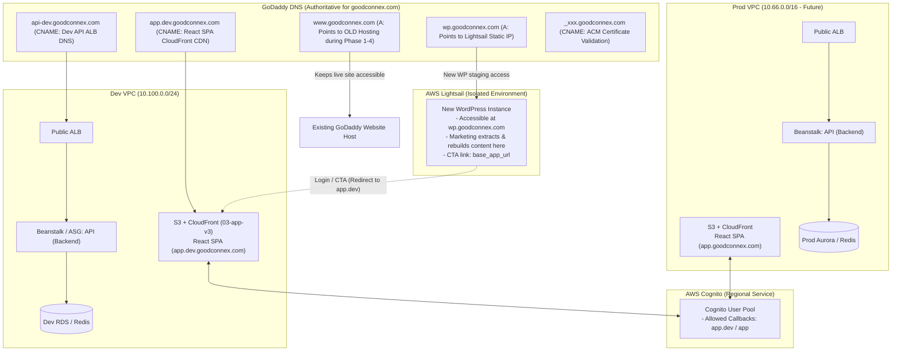

# Web Architecture & Step-by-Step Execution Plan

## 1. Overview & Architecture

This plan details the implementation for building a new marketing website on **AWS Lightsail (WordPress)** while maintaining the existing live site on **GoDaddy** (`www.goodconnex.com`) during content migration. 

**DNS Strategy**: GoDaddy remains the authoritative DNS provider for all phases initially. Subdomains (`wp.goodconnex.com`, `app.dev.goodconnex.com`, `api-dev.goodconnex.com`, and ACM validation CNAMEs) are created directly in GoDaddy DNS. Migration to **Amazon Route 53** is deferred to a later dedicated phase.



---

## 2. Key Strategy: Keep GoDaddy DNS & Zero Downtime

1. **No Nameserver Changes**: GoDaddy remains the DNS authority. No NS changes or delegation to Route 53 at this stage.
2. **Side-by-Side Coexistence**:
   * Current site stays live at `www.goodconnex.com` on existing hosting.
   * New WordPress is launched on AWS Lightsail and mapped to `wp.goodconnex.com` via an `A` record in GoDaddy.
3. **AWS ACM Validation in GoDaddy**: Request a public certificate in AWS Certificate Manager for `*.goodconnex.com` and add the generated CNAME validation record directly into GoDaddy DNS.
4. **Instant Cutover in GoDaddy**: When marketing finishes authoring on WordPress, update the `www` `A` record in GoDaddy to the Lightsail IP.
5. **Future Route 53 Migration**: When ready to move DNS to Route 53 (e.g., alongside production launch), all GoDaddy records can be exported/recreated in Route 53 before changing nameservers.

---

## 3. Step-by-Step Execution Plan

### Phase 1: GoDaddy DNS Inventory & ACM Certificate

1. **Inventory Existing GoDaddy DNS Records**:
   * Export or query all records via GoDaddy API / curl or DNS tools:
     ```bash
     export GODADDY_KEY="your_api_key"
     export GODADDY_SECRET="your_api_secret"
     curl -s -X GET "https://api.godaddy.com/v1/domains/goodconnex.com/records" \
       -H "Authorization: sso-key ${GODADDY_KEY}:${GODADDY_SECRET}" \
       -H "Accept: application/json" > godaddy_dns_backup.json
     ```
2. **Request Wildcard SSL/TLS Certificate in AWS ACM**:
   * In AWS Certificate Manager (`us-west-2`), request a public certificate for `goodconnex.com` and `*.goodconnex.com`.
   * ACM provides a CNAME name and value for DNS validation (e.g. `_a7b8c...goodconnex.com` $\rightarrow$ `_x2y3z...acm-validations.aws.`).
3. **Add ACM Validation CNAME to GoDaddy**:
   * Add the CNAME validation record in GoDaddy DNS Management.
   * Within a few minutes, AWS ACM certificate status becomes **Issued**.

---

### Phase 2: Deploy New WordPress & CloudFront CDN (`wp.goodconnex.com`)

1. **Request ACM Certificate in `us-east-1` for CloudFront**:
   * Request ACM certificate for `wp.goodconnex.com` in `us-east-1` (ARN: `arn:aws:acm:us-east-1:339087217430:certificate/4daf92dd-8152-4a14-9079-ea86dc6247fb`).
   * Validate via DNS in GoDaddy.
2. **Deploy Lightsail & CloudFront via Terraform (`12-web`)**:
   * Provisions Lightsail WordPress (`wordpress_ls_1_0`) on static IP.
   * Provisions AWS CloudFront Distribution in front of the static IP using the `us-east-1` ACM Certificate.
   * CloudFront terminates HTTPS with TLS 1.2, handles gzip compression, forwards essential WordPress cookies/headers, and automatically passes `/wp-admin/*`, `/wp-login.php`, and `/wp-json/*` straight to origin without caching.
3. **Route Traffic in GoDaddy**:
   * Add a CNAME in GoDaddy DNS:
     * **Host**: `wp`
     * **Points to / Value**: `<cloudfront_domain_name>` (e.g. `dxxxxxxxxxxxx.cloudfront.net` from `terraform output cloudfront_domain_name`).
4. **Content Extraction & Authoring**:
   * Marketing authors log in securely via HTTPS to `https://wp.goodconnex.com/wp-admin`.
   * They can extract content from the live `www.goodconnex.com` side-by-side and build new marketing pages.

---

### Phase 3: Deploy Dev Dynamic Application & SPA (`app.dev.goodconnex.com`)

1. **Deploy Dev Infrastructure**:
   * Deploy Dev VPC using [tfvars/dev/01-network-dev.tfvars](tfvars/dev/01-network-dev.tfvars).
   * Deploy Dev Database (RDS & Redis) using [tfvars/dev/02-db-dev.tfvars](tfvars/dev/02-db-dev.tfvars).
   * Deploy Dev API Beanstalk/ASG using `03-ebs-v1` (`api-dev.goodconnex.com`).
   * Deploy Dev React/Vite SPA Infrastructure (S3 Bucket & CloudFront CDN) using [03-app-v3](03-app-v3) (`app.dev.goodconnex.com`).
2. **Attach ACM Certificate**:
   * Dev ALB (API): Wildcard certificate for `*.goodconnex.com` on HTTPS (443) listener.
   * CloudFront CDN (SPA): `us-east-1` ACM certificate covering `app.dev.goodconnex.com` or `*.goodconnex.com`.
3. **Add Subdomain CNAMEs in GoDaddy**:
   * Type: `CNAME` | Host: `app.dev` | Value: `<CloudFront_Distribution_Domain>` (e.g., `d111111abcdef8.cloudfront.net`)
   * Type: `CNAME` | Host: `api-dev` | Value: `<Dev_ALB_DNS_Name>` (e.g., `awseb-e-xxx.us-west-2.elb.amazonaws.com`)

---

### Phase 4: Configure Cognito Authentication

1. **Deploy Cognito User Pool & App Clients**:
   * Configure Cognito User Pool in AWS (`08-cognito`).
   * Create App Client with OAuth / OIDC enabled.
2. **Configure Callback & Sign-Out URLs**:
   * Allowed Callback URLs:
     * `https://app.dev.goodconnex.com/callback`
     * `http://localhost:3000/callback` (for local development)
     * `https://app.goodconnex.com/callback` (pre-configured for production)
   * Allowed Sign-out URLs:
     * `https://app.dev.goodconnex.com/login`
     * `https://wp.goodconnex.com` (during staging)
     * `https://www.goodconnex.com` (for production)
     * `https://app.goodconnex.com/login`
3. **Scope Session Cookies**:
   * Set authentication cookie domain to `.goodconnex.com` or `app.dev.goodconnex.com` with `Secure`, `HttpOnly`, and `SameSite=Lax`.

---

### Phase 5: Integrate Staging WordPress with Dynamic Application

1. **Configurable Base URL Strategy**:
   * In Lightsail WordPress, define a single setting for the application base URL (e.g., via Theme Customizer or WP Options).
   * Staging Value: `https://app.dev.goodconnex.com`
   * Future Production Value: `https://app.goodconnex.com`
2. **Link CTA Buttons**:
   * Set navigation items and buttons (e.g., *Login*, *Get Started*, *Dashboard*) to point to `{APP_BASE_URL}/login` or `{APP_BASE_URL}/register`.
   * **Security Rule**: WordPress never connects directly to RDS or holds database credentials. All dynamic operations flow through `app.dev.goodconnex.com` / `api-dev.goodconnex.com`.

---

### Phase 6: Marketing Cutover in GoDaddy & Production Promotion

1. **Promote Lightsail WordPress to `www.goodconnex.com`**:
   * Add custom domain / SSL certificate in Lightsail for `www.goodconnex.com` and `goodconnex.com`.
   * Update WordPress site URL and home URL from `https://wp.goodconnex.com` to `https://www.goodconnex.com` (e.g., `wp search-replace 'wp.goodconnex.com' 'www.goodconnex.com'`).
   * Update base app URL in WordPress to `https://app.goodconnex.com` (when Prod app is live).
2. **Update GoDaddy DNS for `www`**:
   * Change `A` record for `www` in GoDaddy from old hosting IP $\rightarrow$ `<Lightsail_Static_IP>`.
   * Configure GoDaddy domain forwarding / apex `@` redirect to `https://www.goodconnex.com`.
3. **Deploy Production Stack & Point CNAMEs**:
   * Deploy Prod VPC (`10.66.0.0/16`) and database clusters (Aurora Multi-AZ, ElastiCache).
   * Deploy Prod Beanstalk environments for `app.goodconnex.com` and `api.goodconnex.com`.
   * In GoDaddy DNS, add:
     * Type: `CNAME` | Host: `app` | Value: `<Prod_CloudFront_Domain_or_ALB>`
     * Type: `CNAME` | Host: `api` | Value: `<Prod_ALB_DNS_Name>`
4. **Decommission Old GoDaddy Hosting**:
   * Once cutover is verified, cancel the old hosting package.

---

### Phase 7 (Optional / Later): Route 53 DNS Migration

When you are ready to migrate authoritative DNS from GoDaddy to AWS Route 53:
1. Create a Public Hosted Zone for `goodconnex.com` in Route 53.
2. Replicate all active GoDaddy records (Apex, `www`, `wp`, `app`, `api`, `app.dev`, `api-dev`, MX, TXT).
3. In GoDaddy DNS Management, change nameservers to the 4 AWS Route 53 NS servers.

---

## 4. DNS Records in GoDaddy (Progression Table)

| Record Type | Host / Name | Target / Value (Phases 1–5) | Target / Value (After Cutover - Phase 6) |
| :--- | :--- | :--- | :--- |
| `A` | `www` | Existing GoDaddy Hosting IP | **Lightsail Static IP** |
| `A` | `@` (Apex) | Existing GoDaddy Hosting IP / Forwarding | Forwarding to `https://www.goodconnex.com` |
| `A` | `wp` | **Lightsail Static IP** | Lightsail Static IP (or removed) |
| `CNAME` | `app.dev` | **Dev CloudFront Domain** (`03-app-v3`) | **Dev CloudFront Domain** (`03-app-v3`) |
| `CNAME` | `api-dev` | Dev ALB DNS name | Dev ALB DNS name |
| `CNAME` | `app` | *(Not created yet)* | **Prod CloudFront / ALB DNS name** |
| `CNAME` | `api` | *(Not created yet)* | **Prod ALB DNS name** |
| `CNAME` | `_xxx` (ACM) | AWS ACM Validation Target | AWS ACM Validation Target |

---

## 5. Vite SPA Frontend Deployment to S3 & CloudFront

This guide explains how to build your local Vite Single Page Application (SPA), deploy the generated static assets to the AWS S3 bucket created in [03-app-v3/s3.tf](03-app-v3/s3.tf), and invalidate the CloudFront CDN cache configured in [03-app-v3/cloudfront.tf](03-app-v3/cloudfront.tf).

### 5.1. Retrieve Infrastructure Outputs

Obtain the target S3 bucket name and CloudFront distribution ID from Terraform outputs in [03-app-v3](03-app-v3):

```bash
cd 03-app-v3

# Export variables for deployment
export S3_BUCKET=$(terraform output -raw s3_bucket_name)
export CDN_DIST_ID=$(terraform output -raw cloudfront_distribution_id)

echo "Target Bucket: ${S3_BUCKET}"
echo "Distribution ID: ${CDN_DIST_ID}"
```

---

### 5.2. Build the Vite SPA Locally

Navigate to your local frontend project directory, set up environment variables, and build the production bundle:

```bash
cd /path/to/your/vite-spa

# 1. Install dependencies
npm install

# 2. Configure environment variables (e.g., .env.production)
# VITE_API_BASE_URL=https://api-dev.goodconnex.com
# VITE_COGNITO_USER_POOL_ID=<pool_id>
# VITE_COGNITO_CLIENT_ID=<client_id>

# 3. Create production build (generates 'dist/' directory)
npm run build
```

---

### 5.3. Push / Sync Build Artifacts to S3

To ensure optimal caching performance, sync static assets (hashed JS/CSS/images) with long cache TTLs and sync `index.html` with `no-cache` so users instantly receive application updates:

```bash
# Step 1: Upload hashed assets with immutable long-term caching (1 year)
if [ -d "dist/assets" ]; then
  aws s3 sync dist/assets/ s3://${S3_BUCKET}/assets/ \
    --cache-control "public, max-age=31536000, immutable" \
    --delete
fi

# Step 2: Sync remaining files (including index.html) with no-cache headers
aws s3 sync dist/ s3://${S3_BUCKET}/ \
  --cache-control "no-cache, no-store, must-revalidate" \
  --delete
```

> **Note**: The `--delete` flag removes obsolete assets from S3 that are no longer part of the latest build.

---

### 5.4. Invalidate CloudFront CDN Cache

Trigger a CloudFront cache invalidation so edge locations immediately serve the new release:

```bash
# Invalidate all paths in CloudFront
INVALIDATION_ID=$(aws cloudfront create-invalidation \
  --distribution-id ${CDN_DIST_ID} \
  --paths "/*" \
  --query "Invalidation.Id" \
  --output text)

echo "Created invalidation: ${INVALIDATION_ID}"

# Optional: Wait for the invalidation to complete across all edge locations
aws cloudfront wait invalidation-completed \
  --distribution-id ${CDN_DIST_ID} \
  --id ${INVALIDATION_ID}

echo "CloudFront invalidation complete!"
```

---

### 5.5. Automated Deployment via Script

Use the root-level deployment script [deploy-spa.sh](deploy-spa.sh) to automate building the Vite SPA, syncing assets to S3 with appropriate cache headers, and creating CloudFront cache invalidations in one command:

```bash
# Run from repository root:
./deploy-spa.sh /path/to/vite-spa dev
```

The script automatically fetches `s3_bucket_name` and `cloudfront_distribution_id` from the [03-app-v3](03-app-v3) Terraform module outputs or uses `S3_BUCKET` and `CDN_DIST_ID` environment variables if exported.


