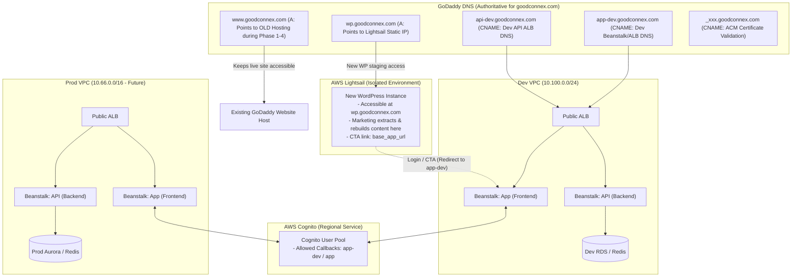

# Web Architecture & Step-by-Step Execution Plan

## 1. Overview & Architecture

This plan details the implementation for building a new marketing website on **AWS Lightsail (WordPress)** while maintaining the existing live site on **GoDaddy** (`www.goodconnex.com`) during content migration. 

**DNS Strategy**: GoDaddy remains the authoritative DNS provider for all phases initially. Subdomains (`wp.goodconnex.com`, `app-dev.goodconnex.com`, `api-dev.goodconnex.com`, and ACM validation CNAMEs) are created directly in GoDaddy DNS. Migration to **Amazon Route 53** is deferred to a later dedicated phase.



---

## 2. Key Strategy: Keep GoDaddy DNS & Zero Downtime

1. **No Nameserver Changes**: GoDaddy remains the DNS authority. No NS changes or delegation to Route 53 at this stage.
2. **Side-by-Side Coexistence**:
   * Current site stays live at `www.goodconnex.com` on existing hosting.
   * New WordPress is launched on AWS Lightsail and mapped to `wp.goodconnex.com` via an `A` record in GoDaddy.
3. **AWS ACM Validation in GoDaddy**: Request a public certificate in AWS Certificate Manager for `*.goodconnex.com` and add the generated CNAME validation record directly into GoDaddy DNS.
4. **Instant Cutover in GoDaddy**: When marketing finishes authoring on WordPress, update the `www` `A` record in GoDaddy to the Lightsail IP.
5. **Future Route 53 Migration**: When ready to move DNS to Route 53 (e.g., alongside production launch), all GoDaddy records can be exported/recreated in Route 53 before changing nameservers.

---

## 3. Step-by-Step Execution Plan

### Phase 1: GoDaddy DNS Inventory & ACM Certificate

1. **Inventory Existing GoDaddy DNS Records**:
   * Export or query all records via GoDaddy API / curl or DNS tools:
     ```bash
     export GODADDY_KEY="your_api_key"
     export GODADDY_SECRET="your_api_secret"
     curl -s -X GET "https://api.godaddy.com/v1/domains/goodconnex.com/records" \
       -H "Authorization: sso-key ${GODADDY_KEY}:${GODADDY_SECRET}" \
       -H "Accept: application/json" > godaddy_dns_backup.json
     ```
2. **Request Wildcard SSL/TLS Certificate in AWS ACM**:
   * In AWS Certificate Manager (`us-west-2`), request a public certificate for `goodconnex.com` and `*.goodconnex.com`.
   * ACM provides a CNAME name and value for DNS validation (e.g. `_a7b8c...goodconnex.com` $\rightarrow$ `_x2y3z...acm-validations.aws.`).
3. **Add ACM Validation CNAME to GoDaddy**:
   * Add the CNAME validation record in GoDaddy DNS Management.
   * Within a few minutes, AWS ACM certificate status becomes **Issued**.

---

### Phase 2: Deploy New WordPress on AWS Lightsail (`wp.goodconnex.com`)

1. **Launch Lightsail Instance**:
   * Platform: Linux/Unix.
   * Blueprint: **`wordpress_ls_1_0`** (AWS native WordPress image on Amazon Linux with IMDSv2 enforced, MariaDB, PHP 8.x, and built-in Lightsail HTTPS workflow — **no Bitnami**).
   * Bundle: Configurable via `bundle_id` (e.g., `micro_3_0` for $5/mo or `small_3_0` for $10/mo).
2. **Attach Static IP**:
   * Allocate and attach a Lightsail Static IP to the WordPress instance.
3. **Add DNS Record in GoDaddy**:
   * Type: `A`
   * Host / Name: `wp`
   * Value: `<Lightsail_Static_IP>`
   * TTL: 600 seconds (or 1/2 hour)
4. **Configure Domain & HTTPS in Lightsail**:
   * Use Lightsail's built-in HTTPS certificate workflow from the Lightsail console or via standard `certbot` on the instance for `wp.goodconnex.com`.
   * Configure WordPress URL (`WP_HOME` and `WP_SITEURL`) to `https://wp.goodconnex.com`.
5. **Content Extraction & Authoring**:
   * Marketing authors log in to `https://wp.goodconnex.com/wp-admin`.
   * They can view the live `www.goodconnex.com` side-by-side, extract content/assets, and build the new WordPress pages.

---

### Phase 3: Deploy Dev Dynamic Application (`app-dev.goodconnex.com`)

1. **Deploy Dev Infrastructure**:
   * Deploy Dev VPC using [tfvars/dev/01-network-dev.tfvars](tfvars/dev/01-network-dev.tfvars).
   * Deploy Dev Database (RDS & Redis) using [tfvars/dev/02-db-dev.tfvars](tfvars/dev/02-db-dev.tfvars).
   * Deploy Dev API Beanstalk using `03-ebs-v1` (`api-dev.goodconnex.com`).
   * Deploy/configure Dev App Beanstalk for dynamic web frontend (`app-dev.goodconnex.com`).
2. **Attach ACM Certificate to Dev ALB**:
   * Attach the issued ACM wildcard certificate to the Dev ALB HTTPS (443) listener.
3. **Add Subdomain CNAMEs in GoDaddy**:
   * Type: `CNAME` | Host: `app-dev` | Value: `<Dev_ALB_DNS_Name>` (e.g., `awseb-e-xxx.us-west-2.elb.amazonaws.com`)
   * Type: `CNAME` | Host: `api-dev` | Value: `<Dev_ALB_DNS_Name>`

---

### Phase 4: Configure Cognito Authentication

1. **Deploy Cognito User Pool & App Clients**:
   * Configure Cognito User Pool in AWS (`08-cognito`).
   * Create App Client with OAuth / OIDC enabled.
2. **Configure Callback & Sign-Out URLs**:
   * Allowed Callback URLs:
     * `https://app-dev.goodconnex.com/callback`
     * `http://localhost:3000/callback` (for local development)
     * `https://app.goodconnex.com/callback` (pre-configured for production)
   * Allowed Sign-out URLs:
     * `https://app-dev.goodconnex.com/login`
     * `https://wp.goodconnex.com` (during staging)
     * `https://www.goodconnex.com` (for production)
     * `https://app.goodconnex.com/login`
3. **Scope Session Cookies**:
   * Set authentication cookie domain to `.goodconnex.com` or `app-dev.goodconnex.com` with `Secure`, `HttpOnly`, and `SameSite=Lax`.

---

### Phase 5: Integrate Staging WordPress with Dynamic Application

1. **Configurable Base URL Strategy**:
   * In Lightsail WordPress, define a single setting for the application base URL (e.g., via Theme Customizer or WP Options).
   * Staging Value: `https://app-dev.goodconnex.com`
   * Future Production Value: `https://app.goodconnex.com`
2. **Link CTA Buttons**:
   * Set navigation items and buttons (e.g., *Login*, *Get Started*, *Dashboard*) to point to `{APP_BASE_URL}/login` or `{APP_BASE_URL}/register`.
   * **Security Rule**: WordPress never connects directly to RDS or holds database credentials. All dynamic operations flow through `app-dev.goodconnex.com` / `api-dev.goodconnex.com`.

---

### Phase 6: Marketing Cutover in GoDaddy & Production Promotion

1. **Promote Lightsail WordPress to `www.goodconnex.com`**:
   * Add custom domain / SSL certificate in Lightsail for `www.goodconnex.com` and `goodconnex.com`.
   * Update WordPress site URL and home URL from `https://wp.goodconnex.com` to `https://www.goodconnex.com` (e.g., `wp search-replace 'wp.goodconnex.com' 'www.goodconnex.com'`).
   * Update base app URL in WordPress to `https://app.goodconnex.com` (when Prod app is live).
2. **Update GoDaddy DNS for `www`**:
   * Change `A` record for `www` in GoDaddy from old hosting IP $\rightarrow$ `<Lightsail_Static_IP>`.
   * Configure GoDaddy domain forwarding / apex `@` redirect to `https://www.goodconnex.com`.
3. **Deploy Production Stack & Point CNAMEs**:
   * Deploy Prod VPC (`10.66.0.0/16`) and database clusters (Aurora Multi-AZ, ElastiCache).
   * Deploy Prod Beanstalk environments for `app.goodconnex.com` and `api.goodconnex.com`.
   * In GoDaddy DNS, add:
     * Type: `CNAME` | Host: `app` | Value: `<Prod_ALB_DNS_Name>`
     * Type: `CNAME` | Host: `api` | Value: `<Prod_ALB_DNS_Name>`
4. **Decommission Old GoDaddy Hosting**:
   * Once cutover is verified, cancel the old hosting package.

---

### Phase 7 (Optional / Later): Route 53 DNS Migration

When you are ready to migrate authoritative DNS from GoDaddy to AWS Route 53:
1. Create a Public Hosted Zone for `goodconnex.com` in Route 53.
2. Replicate all active GoDaddy records (Apex, `www`, `wp`, `app`, `api`, `app-dev`, `api-dev`, MX, TXT).
3. In GoDaddy DNS Management, change nameservers to the 4 AWS Route 53 NS servers.

---

## 4. DNS Records in GoDaddy (Progression Table)

| Record Type | Host / Name | Target / Value (Phases 1–5) | Target / Value (After Cutover - Phase 6) |
| :--- | :--- | :--- | :--- |
| `A` | `www` | Existing GoDaddy Hosting IP | **Lightsail Static IP** |
| `A` | `@` (Apex) | Existing GoDaddy Hosting IP / Forwarding | Forwarding to `https://www.goodconnex.com` |
| `A` | `wp` | **Lightsail Static IP** | Lightsail Static IP (or removed) |
| `CNAME` | `app-dev` | Dev ALB DNS name | Dev ALB DNS name |
| `CNAME` | `api-dev` | Dev ALB DNS name | Dev ALB DNS name |
| `CNAME` | `app` | *(Not created yet)* | **Prod ALB DNS name** |
| `CNAME` | `api` | *(Not created yet)* | **Prod ALB DNS name** |
| `CNAME` | `_xxx` (ACM) | AWS ACM Validation Target | AWS ACM Validation Target |


