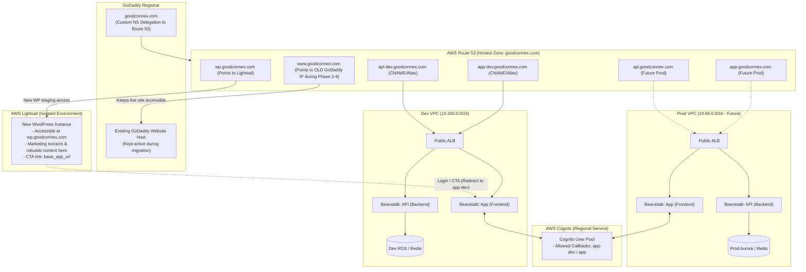

# Web Architecture & Step-by-Step Execution Plan

## 1. Overview & Architecture

This plan details the implementation for building a new marketing website on **AWS Lightsail (WordPress)** while maintaining the existing live site on **GoDaddy** (`www.goodconnex.com`) during content migration. The new WordPress site will initially be staged on a temporary subdomain (`wp.goodconnex.com`), integrated with a dynamic application running on **AWS Elastic Beanstalk** (`app-dev.goodconnex.com` / `api-dev.goodconnex.com` in Dev VPC, transitioning to `app.goodconnex.com` / `api.goodconnex.com` in Prod VPC), authenticated via **AWS Cognito**, with DNS delegated from **GoDaddy** to **Amazon Route 53**.

---

## 2. Key Strategy: Zero-Downtime Migration & Staging

Because the existing `www.goodconnex.com` is live on GoDaddy hosting:
1. **Do not immediately point `www.goodconnex.com` to Lightsail**.
2. **Replicate existing DNS records in Route 53 first**: Before changing nameservers at GoDaddy, copy the existing GoDaddy hosting IP into Route 53 so the live site experiences zero downtime when nameservers switch.
3. **Use a Staging Subdomain for Lightsail**: Spin up Lightsail under `wp.goodconnex.com`. Marketing can build, extract, and format content on Lightsail while viewing the old site side-by-side.
4. **Instant Cutover**: When the new WordPress site is finished and approved, switch the `www.goodconnex.com` Route 53 record to point to the Lightsail instance and decommission the old hosting.

---

## 3. Step-by-Step Execution Plan

### Phase 1: DNS Setup & Domain Delegation (GoDaddy $\rightarrow$ Route 53)

1. **Inventory Existing GoDaddy DNS Records**:
   * Log in to GoDaddy and record ALL current DNS records (e.g., existing hosting `A` record for `www` and apex `@`, MX records for email/Office 365/Google Workspace, TXT records for SPF/DKIM).
2. **Create Public Hosted Zone in AWS Route 53**:
   * Create a public hosted zone for `goodconnex.com`.
   * Recreate **all** existing records in Route 53:
     * `www.goodconnex.com` $\rightarrow$ Existing GoDaddy hosting IP.
     * `goodconnex.com` $\rightarrow$ Existing GoDaddy hosting IP.
     * Copy all existing MX, TXT, and CNAME records.
   * Add a staging record for the upcoming Lightsail instance:
     * `wp.goodconnex.com` $\rightarrow$ Lightsail Static IP.
3. **Delegate DNS in GoDaddy**:
   * In GoDaddy DNS Management, change nameservers to the 4 AWS Route 53 nameservers.
   * **Result**: The existing website and email continue functioning without any disruption.
4. **Request Wildcard SSL/TLS Certificate in AWS Certificate Manager (ACM)**:
   * Request a public certificate in region `us-west-2` (and `us-east-1` if using CloudFront).
   * Domain names: `goodconnex.com` and `*.goodconnex.com`.
   * Complete DNS validation via Route 53.

---

### Phase 2: Deploy New WordPress on AWS Lightsail in Staging

1. **Launch Lightsail Instance**:
   * Platform: Linux/Unix.
   * Blueprint: **WordPress** (packaged by Bitnami / AWS).
   * Choose instance plan (e.g., $5–$10/mo tier).
2. **Attach Static IP**:
   * Allocate and attach a Lightsail Static IP to the WordPress instance.
3. **Configure Staging Domain & HTTPS in Lightsail**:
   * Use Bitnami `bncert-tool` (or Lightsail distribution) to configure SSL for `wp.goodconnex.com`.
   * Configure WordPress URL (`WP_HOME` and `WP_SITEURL`) to `https://wp.goodconnex.com`.
4. **Content Extraction & Authoring**:
   * Marketing authors log in to `https://wp.goodconnex.com/wp-admin`.
   * They can extract text, images, and content from the live `www.goodconnex.com` (running on old hosting) and rebuild/modernize it inside the new Lightsail instance.

---

### Phase 3: Deploy Dev Dynamic Application (`app-dev.goodconnex.com`)

1. **Deploy Dev Infrastructure**:
   * Deploy the Dev VPC using [tfvars/dev/01-network-dev.tfvars](tfvars/dev/01-network-dev.tfvars).
   * Deploy Dev Database (RDS & Redis) using [tfvars/dev/02-db-dev.tfvars](tfvars/dev/02-db-dev.tfvars).
   * Deploy Dev API Beanstalk using `03-ebs-v1` (`api-dev.goodconnex.com`).
   * Deploy/configure Dev App Beanstalk for dynamic web frontend (`app-dev.goodconnex.com`).
2. **Configure Load Balancer & SSL**:
   * Attach the ACM wildcard certificate to the Dev ALB HTTPS (443) listener.
   * Route traffic to the dynamic application environment.
3. **Create Route 53 Records**:
   * Create `A` (Alias) or `CNAME` for `app-dev.goodconnex.com` $\rightarrow$ Dev ALB DNS.
   * Create `A` (Alias) or `CNAME` for `api-dev.goodconnex.com` $\rightarrow$ Dev ALB DNS.

---

### Phase 4: Configure Cognito Authentication

1. **Deploy Cognito User Pool & App Clients**:
   * Configure Cognito User Pool in AWS (`08-cognito`).
   * Create App Client with OAuth / OIDC enabled.
2. **Configure Callback & Sign-Out URLs**:
   * Allowed Callback URLs:
     * `https://app-dev.goodconnex.com/callback`
     * `http://localhost:3000/callback` (for local development)
     * `https://app.goodconnex.com/callback` (pre-configured for production)
   * Allowed Sign-out URLs:
     * `https://app-dev.goodconnex.com/login`
     * `https://wp.goodconnex.com` (during staging)
     * `https://www.goodconnex.com` (for production)
     * `https://app.goodconnex.com/login`
3. **Scope Session Cookies**:
   * Set authentication cookie domain to `.goodconnex.com` or `app-dev.goodconnex.com` with `Secure`, `HttpOnly`, and `SameSite=Lax`.

---

### Phase 5: Integrate Staging WordPress with Dynamic Application

1. **Configurable Base URL Strategy**:
   * In Lightsail WordPress, define a single setting for the application base URL (e.g., via Theme Customizer or WP Options).
   * Staging Value: `https://app-dev.goodconnex.com`
   * Future Production Value: `https://app.goodconnex.com`
2. **Link CTA Buttons**:
   * Set navigation items and buttons (e.g., *Login*, *Get Started*, *Dashboard*) to point to `{APP_BASE_URL}/login` or `{APP_BASE_URL}/register`.
   * **Security Rule**: WordPress never connects directly to RDS or holds database credentials. All dynamic operations flow through `app-dev.goodconnex.com` / `api-dev.goodconnex.com`.

---

### Phase 6: Production Promotion & Final Marketing Cutover

1. **Deploy Production Stack**:
   * Deploy Prod VPC (`10.66.0.0/16`) and database clusters (Aurora Multi-AZ, ElastiCache).
   * Deploy Prod Beanstalk environments for `app.goodconnex.com` and `api.goodconnex.com`.
   * Add Route 53 records for `app.goodconnex.com` and `api.goodconnex.com` pointing to Prod ALB.
2. **Promote Lightsail WordPress from Staging to `www.goodconnex.com`**:
   * Re-run Bitnami HTTPS tool (`bncert-tool`) on Lightsail to add certificates for `www.goodconnex.com` and `goodconnex.com`.
   * Update WordPress site URL and home URL from `https://wp.goodconnex.com` to `https://www.goodconnex.com` (e.g., using `wp-cli` search-replace: `wp search-replace 'wp.goodconnex.com' 'www.goodconnex.com'`).
   * Update the base app URL in WordPress to `https://app.goodconnex.com`.
3. **Switch Route 53 DNS for `www` & Apex**:
   * Update Route 53 `A` record for `www.goodconnex.com` $\rightarrow$ Lightsail Static IP (replaces old GoDaddy hosting IP).
   * Update Route 53 `A` record for `goodconnex.com` $\rightarrow$ Redirect to `www.goodconnex.com` or Lightsail Static IP.
4. **Decommission Old Hosting**:
   * After verification and DNS propagation, retire the old hosting package at GoDaddy.

---

## 4. Domain & Routing Progression Table

| Subdomain | During Content Migration (Phases 1–5) | After Final Cutover (Phase 6) |
| :--- | :--- | :--- |
| `www.goodconnex.com` | Old GoDaddy Hosting (Live site to extract from) | **New Lightsail WordPress** |
| `wp.goodconnex.com` | **New Lightsail WordPress** (Authoring & testing) | Decommissioned / Internal Staging |
| `app-dev.goodconnex.com` | Dev Beanstalk App (Dev VPC) | Dev Beanstalk App (Dev VPC) |
| `api-dev.goodconnex.com` | Dev Beanstalk API (Dev VPC) | Dev Beanstalk API (Dev VPC) |
| `app.goodconnex.com` | Not deployed yet | **Prod Beanstalk App (Prod VPC)** |
| `api.goodconnex.com` | Not deployed yet | **Prod Beanstalk API (Prod VPC)** |

